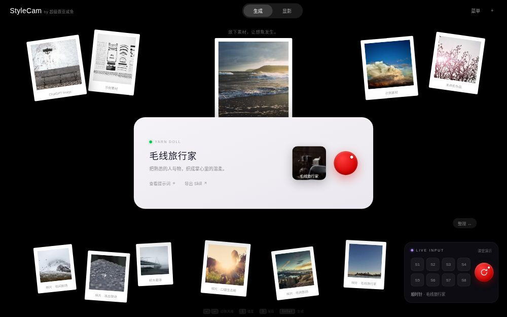

# StyleCam · 风格调色盘

第七期 AI 硬件训练营第 6 课作业 —— 把 EasyInput AI 键盘变成一台「旋转选风格、调节创意、生成图片」的创作设备的网页复刻版。

> 旋钮负责探索，按键负责动作，AI 负责把选定的创意变成新画面。

单文件 HTML，浏览器直接打开即用，无需构建、无需后端、无需 API Key（样片用占位图，本地演示模式）。



## 设计风格

- 纯黑背景 + 白色大圆角打印机卡片，强对比、克制高级
- 所有样片带拍立得白边框，自然散落、微角度旋转
- 红色旋钮唯一暖色点缀；右下角 LIVE INPUT 硬件面板实时映射按键状态

## 核心交互

| 操作 | 键盘 | 说明 |
|---|---|---|
| 旋转选风格 | `←` / `→` | 10 种风格沿圆形转盘切换，选中项放大突出，白点跟随旋钮旋转 |
| 旋钮短按 / 生成 | `Enter` | 生成当前风格样片，弹出拍立得结果 |
| S1 创意强度 | `1` | 弹窗调强度（←→ 调节） |
| S2 查看 | `2` | 查看模式 |
| S3 保存 | `3` | 下载当前作品 |
| S4 收起 | `4` | 关闭结果 |
| S5 对比 | `5` | 对比原图 |
| S6 灵感 | `6` | AI 灵感 |
| S7 重置 | `7` | 强度复位 65 |
| S8 模式 | `8` | 生成 / 显影切换 |
| 关闭弹窗 | `Esc` | — |

右下角 LIVE INPUT 面板会同步反映：按下对应数字键时 S1~S8 按键高亮，旋转方向键时硬件旋钮白点转动、底部显示「顺时针/逆时针 · 当前风格」。也可以直接点击面板上的按键触发。

## 10 种风格

1. 毛线旅行家 YARN DOLL
2. 积木星球 BRICK PLANET
3. 机甲模型盒 MECHA KIT
4. 掌上像素梦 PIXEL DREAM
5. 软陶盲盒 CLAY BLIND BOX
6. 纸间剧场 PAPER THEATRE
7. 液态银诗 LIQUID SILVER
8. 果冻宇宙 GUMMY COSMOS
9. 口袋生态舱 POCKET ECO
10. 孔版夏日 RISOGRAPH

## 运行

直接用浏览器打开 `stylecam.html` 即可。

```bash
# 或本地起一个静态服务
npx serve .
```

## 技术

- 原生 HTML/CSS/JS，零依赖、单文件
- 圆形转盘：`rotate()→translate()→rotate()` 圆周定位，果冻弹性曲线 `cubic-bezier(.34,1.42,.48,1)`
- 硬件面板状态：键盘事件双向联动，毛玻璃拟物
